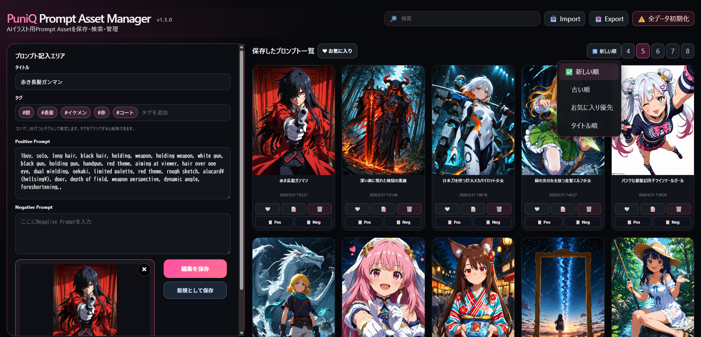

# 🎨 PuniQ Prompt Asset Manager

**Version 1.5.0 · 2026-09-10** — [Release notes / 更新履歴](RELEASE_NOTES.md)



---

## [☕ Support on Ko-fi](https://ko-fi.com/puniq)

**[日本語](#日本語) | [English](#english) | [繁體中文](#繁體中文) | [Español](#español)**

---

<a name="日本語"></a>

# 🇯🇵 日本語

## これは何？

**PuniQ Prompt Asset Manager** は、Stable Diffusion などのAI画像生成ツールで使う「プロンプト（呪文）」をローカルで管理できるアプリです。

> 💡 **プロンプトとは？** AIに絵を描いてもらうときに入力するテキストのことです。「anime girl, white dress, flower field」のような文章で、AIへの指示書のようなものです。

ブラウザ上で動くので、インストールは最小限。データはすべて **自分のパソコンの中だけに保存**されます。外部サーバーには何も送信しません。

---

## 主な機能

- ✅ プロンプトの保存・編集・削除
- 🗑 削除した資産をゴミ箱から復元、または確認後に完全削除
- 🖼 サムネイル画像の登録
- 🔎 サムネイルへマウスを重ねて拡大プレビュー
- 🏷 タグで分類
- ❤️ お気に入り管理
- 🔍 フリーワード検索
- ☑ 複数選択、一括削除・エクスポート・タグ編集・お気に入り変更
- ↔ 登録フォームの折りたたみ・展開
- 📝 プロンプトとは独立した備考の保存・編集・検索
- 📤 CSVとサムネイルをZIPでエクスポート（バックアップ）
- 📥 CSVまたはZIPの件数・画像・重複を確認して安全にインポート

### v1.5.0の入力エリア

左上のピンクのボタンで折りたたみ・展開できます。開閉前後でボタンの位置が変わらず、入力中の内容も保持されます。デスクトップでは表示可能な高さに合わせて各入力欄を調整し、モバイルでは上下アイコンで開閉します。備考はプロンプトのコピーに含まれず、専用のコピーボタンもありません。備考はZIP内のCSVにも保存され、備考列のない旧CSVも読み込めます。

ホバープレビューの最大幅は640pxです。登録時に縮小・圧縮した画像を使用するため、元画像と同じ画質ではありません。

Windowsの黒いサーバー画面は `Prompt Asset Manager - Local Server` と表示されます。通常の起動ポートは旧版の5173から **4177** へ変更しました。既存の `data` フォルダは引き続き使用できます。ブラウザ内だけに残る旧データの移行方法は下記を参照してください。

---

## 必要なもの

- **Node.jsのLTS版**
  1. まず `start_puniq_pam.bat` をダブルクリックし、アプリが開けば導入済みです。
  2. 「Node.js is not installed...」と表示された場合は、[Node.js公式ダウンロードページ](https://nodejs.org/en/download)を開きます。
  3. **LTS（長期サポート版）**のWindows用インストーラー（`.msi`）をダウンロードします。「Current」ではなく「LTS」を選んでください。
  4. `.msi`を実行し、基本的に `Next` → 利用規約に同意 → `Next` → `Install` → `Finish` と初期設定のまま進めます。
  5. Windowsを再起動し、もう一度BATを実行します。

確認したい場合は、スタートメニューで「コマンドプロンプト」を開き、`node -v`を入力します。`v24...`のように`v`から始まる番号が表示されれば準備完了です。番号は例と違っていても問題ありません。

---

## 起動方法

### Windowsの場合

#### ステップ1：ファイルをダウンロードする

このページの右上にある緑色の「**Code**」ボタンをクリック →「**Download ZIP**」を選んでダウンロードします。

ダウンロードしたZIPを**好きな場所に解凍**してください。
例：`C:\Users\あなたの名前\Documents\puniq-prompt-asset-manager`

---

#### ステップ2：アプリを起動する

`start_puniq_pam.bat` を**ダブルクリック**するとブラウザが自動で開きます。

初回は必要なnpmファイルをBATが自動で導入するため、インターネット接続が必要です。手動で`npm install`を実行する必要はありません。

> [!IMPORTANT]
> 通常は必ず `start_puniq_pam.bat` から起動し、自動で開く `http://localhost:4177/` を使用してください。`127.0.0.1`や別のポートで開くと、ブラウザ保存は別扱いになります。

- 起動中は、タスクバーに最小化されている「Prompt Asset Manager - Local Server」のサーバー画面を閉じないでください。
- 2回目以降もBATをダブルクリックするだけです。
- BATは自分のフォルダを自動認識するため、パスの書き換えは不要です。

#### 以前のブラウザからデータを移す

旧版の `http://localhost:5173/` にだけデータがあり、`data`フォルダがまだ空の場合は、先に旧ポートで一度だけ移行します。

1. 5173番ポートを使用している他のアプリを終了します。
2. このフォルダで `npm run dev -- --host localhost --port 5173 --strictPort` を実行します。
3. **以前データを入力していたブラウザ**で `http://localhost:5173/` を開きます。
4. 旧データが表示され、`data/prompt-assets.json`が作成されたらサーバーを終了します。
5. 以後は`start_puniq_pam.bat`から `http://localhost:4177/` を使用します。

---

### Mac / Linuxの場合

ターミナルを開いて以下を順番に実行：

```bash
# フォルダに移動
cd puniq-prompt-asset-manager

# 必要なファイルをインストール（初回のみ）
npm install

# アプリを起動
npm run dev
```

ブラウザで `http://localhost:4177` を開いてください。

---

## 使い方

### プロンプトを保存する

1. 上部の「プロンプト記入エリア」でタイトル・プロンプトを入力
2. サムネイル画像を選ぶ（任意）
3. タグをつける（任意）
4. 「保存」ボタンをクリック

### バックアップ（エクスポート）

- 右上の「📤 Export」ボタンをクリック
- **保存ダイアログ対応ブラウザ** → ZIPの保存先とファイル名を選択します。ZIP内にCSVと画像がまとめて保存されます
- **Brave・その他ブラウザ** → `タイムスタンプ_export.zip` として自動ダウンロードされます（ZIP内の構造は同じ）

### 復元（インポート）

- 「📥 Import」ボタンからCSVまたはZIPファイルを選ぶと、取り込み件数・画像数・重複候補が表示されます
- 重複を除いて追加、すべて追加、現在の一覧を置き換える、の3方式から選べます
- 実行直前の状態は1世代自動退避され、「インポート前に戻す」から復元できます
- ZIPを選ぶとサムネイル画像も一緒に復元されます

---

## データはどこに保存される？

| データ | 主な保存場所 |
| ------ | ------------ |
| プロンプト・タグ・お気に入り・表示設定 | `data/prompt-assets.json` |
| ひとつ前のプロンプトデータ | `data/prompt-assets.previous.json` |
| サムネイル画像 | `data/images/` |
| 補助キャッシュ | 現在のブラウザのlocalStorage / IndexedDB |

BAT起動時はブラウザを変更しても同じ`data`フォルダを読み込みます。ブラウザキャッシュを消しても主データは残りますが、アプリのフォルダ自体を削除すると`data`も消えるため、定期的に「📤 Export」でZIPバックアップを取ってください。

> [!WARNING]
> GitHubから新しい版をダウンロードしてフォルダごと交換する場合は、先に古い版の`data`フォルダを安全な場所へコピーしてください。

---

## ☕ Support

このプロジェクトが役に立った場合は、Ko-fiで今後の開発を応援していただけると嬉しいです。

☕ https://ko-fi.com/puniq

ご支援ありがとうございます！

---

## ライセンス

MIT License © 2026 PuniQ

---

<a name="english"></a>

# 🇺🇸 English

## What is this?

**PuniQ Prompt Asset Manager** is a local prompt management app for AI image generation tools like Stable Diffusion.

> 💡 **What's a prompt?** It's the text you type to tell an AI what to draw — something like `anime girl, white dress, flower field`. Think of it as a recipe for the AI.

It runs in your browser and stores everything **locally on your own PC**. Nothing is sent to any external server.

---

## Features

**New in v1.5.0:** Trash and restore; import preview with duplicate handling and one-step rollback; multi-select and bulk delete/export/tag/favorite actions; independent searchable notes included in exports; a pink collapse toggle that stays in place; desktop form sizing based on available viewport height; hover previews up to 640px. Notes are never added to copied prompts. Older CSVs without notes remain supported. The Windows server window is named `Prompt Asset Manager - Local Server`. The default port is now **4177**; existing local data files are reused, while browser-only data from port 5173 requires the migration steps below.

- ✅ Save, edit, and delete prompts
- 🖼 Attach thumbnail images
- 🏷 Organize with tags
- ❤️ Mark favorites
- 🔍 Free-word search
- 📤 Export CSV and thumbnails together as ZIP (backup)
- 📥 Import from CSV or ZIP (restore)

---

## Requirements

- **Node.js LTS**
  1. First, double-click `start_puniq_pam.bat`. If the app opens, Node.js is already installed.
  2. If it says “Node.js is not installed...”, open the [official Node.js download page](https://nodejs.org/en/download).
  3. Download the Windows installer (`.msi`) for the **LTS** release, not “Current.”
  4. Run the installer with its default options, then restart Windows.

To verify it, open Command Prompt and enter `node -v`. A number beginning with `v` means it is ready.

---

## How to Run

### Windows

#### Step 1: Download the files

Click the green **Code** button at the top right of this page → Select **Download ZIP** and download it.

**Extract the ZIP** to wherever you like.
Example: `C:\Users\YourName\Documents\puniq-prompt-asset-manager`

---

#### Step 2: Launch the app

**Double-click** `start_puniq_pam.bat` — your browser will open automatically.

On the first launch, the BAT automatically installs the required npm dependencies, so an internet connection is required. You do not need to run `npm install` manually.

> [!IMPORTANT]
> Always launch with `start_puniq_pam.bat` and use `http://localhost:4177/`. Keep the minimized server window open while using the app.

#### Migrate data from a previous browser

If data exists only at the legacy `http://localhost:5173/` origin and local file storage is empty, close the app currently using port 5173 and run `npm run dev -- --host localhost --port 5173 --strictPort` once. Open that URL in the previous browser, wait for `data/prompt-assets.json` to be created, stop the server, and then use the BAT at `http://localhost:4177/`.

---

### Mac / Linux

Open a terminal and run the following:

```bash
# Navigate to the folder
cd puniq-prompt-asset-manager

# Install dependencies (first time only)
npm install

# Start the app
npm run dev
```

Then open `http://localhost:4177` in your browser.

---

## How to Use

### Saving a Prompt

1. Fill in the title and prompt text in the form at the top
2. Optionally attach a thumbnail image
3. Optionally add tags
4. Click the **Save** button

### Backup (Export)

- Click the **📤 Export** button
- **Browsers supporting the save dialog** → Choose a ZIP filename and destination; the ZIP contains the CSV and thumbnail images
- **Brave & other browsers** → A `timestamp_export.zip` file will be downloaded automatically (same folder structure inside)

### Restore (Import)

- Click **📥 Import** and select a CSV or ZIP file to restore your prompts
- Review counts and duplicates, then append without duplicates, append all, or replace the current list. The previous state is retained for rollback.
- Selecting a ZIP file will also restore thumbnail images

---

## Where is my data stored?

| Data | Primary storage |
| ---- | --------------- |
| Prompts, tags, favorites, and display settings | `data/prompt-assets.json` |
| Previous prompt data | `data/prompt-assets.previous.json` |
| Thumbnail images | `data/images/` |
| Secondary cache | Current browser localStorage / IndexedDB |

Browsers share the same `data` folder when launched through the BAT. Export ZIP backups regularly, and copy the `data` folder before replacing the whole app folder with a newer release.

---

## ☕ Support

If you find this project useful and would like to support future development, you can support me on Ko-fi.

☕ https://ko-fi.com/puniq

Thank you for your support!

---

## License

MIT License © 2026 PuniQ

---

<a name="繁體中文"></a>

# 🇹🇼 繁體中文

## 這是什麼？

**PuniQ Prompt Asset Manager** 是一款在本機管理 AI 圖像生成工具（如 Stable Diffusion）所用「提示詞（Prompt）」的應用程式。

> 💡 **什麼是提示詞？** 就是你輸入給 AI 的文字指令，例如 `anime girl, white dress, flower field`。可以把它想成給 AI 的繪圖說明書。

這款應用程式在瀏覽器中運行，所有資料都**只儲存在您自己的電腦裡**，不會傳送到任何外部伺服器。

---

## 主要功能

**v1.5.0新增：** 垃圾桶與還原、匯入預覽與重複處理、匯入前狀態還原、多選與批次刪除／匯出／標籤／最愛操作。新增獨立備註，可搜尋並隨CSV匯出，不會加入複製的提示詞。粉紅色開關在收合前後保持相同位置；桌面輸入區依視窗可用高度調整，懸停預覽最大寬度為640px。Windows伺服器視窗名稱為 `Prompt Asset Manager - Local Server`，預設連接埠改為 **4177**。原有本機資料檔可繼續使用；僅存在5173瀏覽器儲存空間的資料請依下方步驟移轉。

- ✅ 儲存、編輯、刪除提示詞
- 🖼 附加縮圖圖片
- 🏷 用標籤分類整理
- ❤️ 加入最愛
- 🔍 關鍵字搜尋
- 📤 將CSV與縮圖一起匯出為ZIP（備份）
- 📥 從 CSV 或 ZIP 匯入（還原）

---

## 必要條件

- **Node.js LTS版**
  1. 先雙擊 `start_puniq_pam.bat`。若應用程式正常開啟，表示已安裝Node.js。
  2. 若顯示「Node.js is not installed...」，請開啟[Node.js官方下載頁面](https://nodejs.org/en/download)。
  3. 下載 **LTS** 的Windows安裝程式（`.msi`），不要選擇「Current」。
  4. 使用預設選項完成安裝，然後重新啟動Windows。

可在命令提示字元輸入 `node -v`；若顯示以`v`開頭的版本號，即表示準備完成。

---

## 啟動方式

### Windows

#### 步驟 1：下載檔案

點擊本頁右上角的綠色「**Code**」按鈕 →「**Download ZIP**」下載。

將 ZIP 解壓縮到您喜歡的位置。
例如：`C:\Users\您的名稱\Documents\puniq-prompt-asset-manager`

---

#### 步驟 2：啟動應用程式

雙擊 `start_puniq_pam.bat`，瀏覽器會自動開啟。

首次啟動時，BAT會自動安裝必要的npm套件，因此需要網路連線，不必手動執行 `npm install`。

> [!IMPORTANT]
> 請固定透過 `start_puniq_pam.bat` 啟動，並使用 `http://localhost:4177/`。使用期間請勿關閉最小化的伺服器視窗。

#### 從舊瀏覽器移轉資料

若資料只存在舊版 `http://localhost:5173/` 且本機檔案仍是空的，請先關閉占用5173連接埠的應用程式，執行 `npm run dev -- --host localhost --port 5173 --strictPort`，再用原本的瀏覽器開啟該網址。確認建立 `data/prompt-assets.json` 後停止伺服器，之後改用BAT的 `http://localhost:4177/`。

---

### Mac / Linux

開啟終端機，依序執行以下指令：

```bash
# 移動到資料夾
cd puniq-prompt-asset-manager

# 安裝所需套件（僅第一次需要）
npm install

# 啟動應用程式
npm run dev
```

接著在瀏覽器開啟 `http://localhost:4177`。

---

## 使用方式

### 儲存提示詞

1. 在上方的輸入區填寫標題與提示詞
2. 可選擇附加縮圖圖片
3. 可選擇新增標籤
4. 點擊「保存」按鈕

### 備份（匯出）

- 點擊右上角的「📤 Export」按鈕
- **支援儲存對話框的瀏覽器** → 選擇ZIP檔名與儲存位置；ZIP內包含CSV與縮圖
- **Brave 及其他瀏覽器** → 會自動下載 `時間戳記_export.zip` 檔案（ZIP 內結構相同）

### 還原（匯入）

- 點擊「📥 Import」按鈕，選擇 CSV 或 ZIP 檔案即可匯入
- 確認筆數與重複項目後，可選擇排除重複新增、全部新增或取代清單，並可還原至匯入前的狀態。缺少備註欄的舊CSV仍可匯入。
- 選擇 ZIP 檔案時，縮圖圖片也會一併還原

---

## 資料儲存在哪裡？

| 資料 | 主要儲存位置 |
| ---- | ------------ |
| 提示詞、標籤、最愛與顯示設定 | `data/prompt-assets.json` |
| 上一份提示詞資料 | `data/prompt-assets.previous.json` |
| 縮圖圖片 | `data/images/` |
| 輔助快取 | 目前瀏覽器的localStorage / IndexedDB |

透過BAT啟動時，不同瀏覽器會共用同一個`data`資料夾。請定期匯出ZIP備份；若要更換整個應用程式資料夾，請先複製舊版的`data`資料夾。

---

## ☕ Support

如果這個專案對您有幫助，歡迎透過 Ko-fi 支持後續開發。

☕ https://ko-fi.com/puniq

感謝您的支持！

---

## 授權條款

MIT License © 2026 PuniQ

---

<a name="español"></a>

# 🇪🇸 Español

## ¿Qué es esto?

**PuniQ Prompt Asset Manager** es una aplicación local para gestionar los "prompts" (instrucciones de texto) que se usan en herramientas de generación de imágenes con IA como Stable Diffusion.

> 💡 **¿Qué es un prompt?** Es el texto que le escribes a la IA para decirle qué dibujar, por ejemplo: `anime girl, white dress, flower field`. Es como una receta de cocina, pero para la inteligencia artificial.

La aplicación funciona en tu navegador y guarda todo **únicamente en tu propio ordenador**. No se envía ningún dato a servidores externos.

---

## Funciones principales

**Novedades de v1.5.0:** Papelera y restauración; vista previa de importación con control de duplicados y recuperación del estado anterior; selección múltiple y acciones de eliminación, exportación, etiquetas y favoritos. Notas independientes que se pueden buscar y exportar, sin incluirlas en los prompts copiados. El botón rosa permanece en la misma posición al plegar y desplegar; el formulario de escritorio se adapta a la altura disponible y la vista previa de imágenes alcanza 640px. La ventana del servidor se llama `Prompt Asset Manager - Local Server`. El puerto predeterminado cambia a **4177**. Se conservan los archivos locales existentes; los datos guardados solo en el navegador en el puerto 5173 requieren la migración indicada abajo.

- ✅ Guardar, editar y eliminar prompts
- 🖼 Adjuntar imágenes en miniatura
- 🏷 Organizar con etiquetas
- ❤️ Marcar favoritos
- 🔍 Búsqueda por palabras clave
- 📤 Exportar CSV y miniaturas en un ZIP (copia de seguridad)
- 📥 Importar desde CSV o ZIP (restaurar)

---

## Requisitos

- **Node.js LTS**
  1. Primero, haz doble clic en `start_puniq_pam.bat`. Si se abre la aplicación, Node.js ya está instalado.
  2. Si aparece “Node.js is not installed...”, abre la [página oficial de descarga de Node.js](https://nodejs.org/en/download).
  3. Descarga el instalador de Windows (`.msi`) de la versión **LTS**, no “Current”.
  4. Instálalo con las opciones predeterminadas y reinicia Windows.

Para comprobarlo, abre el Símbolo del sistema y escribe `node -v`. Un número que empieza por `v` indica que está listo.

---

## Cómo ejecutarlo

### Windows

#### Paso 1: Descargar los archivos

Haz clic en el botón verde **Code** en la parte superior derecha de esta página → Selecciona **Download ZIP** y descárgalo.

**Extrae el ZIP** donde quieras.
Ejemplo: `C:\Users\TuNombre\Documents\puniq-prompt-asset-manager`

---

#### Paso 2: Iniciar la aplicación

Haz doble clic en `start_puniq_pam.bat` y el navegador se abrirá automáticamente.

En el primer inicio, el BAT instala automáticamente las dependencias npm necesarias, por lo que se requiere conexión a Internet. No necesitas ejecutar `npm install` manualmente.

> [!IMPORTANT]
> Inicia siempre con `start_puniq_pam.bat` y usa `http://localhost:4177/`. Mantén abierta la ventana minimizada del servidor mientras uses la aplicación.

#### Migrar datos desde el navegador anterior

Si los datos solo existen en el origen anterior `http://localhost:5173/` y el archivo local aún está vacío, cierra la aplicación que use el puerto 5173 y ejecuta una vez `npm run dev -- --host localhost --port 5173 --strictPort`. Abre esa URL con el navegador anterior, espera a que se cree `data/prompt-assets.json`, detén el servidor y después usa el BAT en `http://localhost:4177/`.

---

### Mac / Linux

Abre una terminal y ejecuta los siguientes comandos en orden:

```bash
# Entrar a la carpeta
cd puniq-prompt-asset-manager

# Instalar dependencias (solo la primera vez)
npm install

# Iniciar la aplicación
npm run dev
```

Luego abre `http://localhost:4177` en tu navegador.

---

## Cómo usarlo

### Guardar un prompt

1. Rellena el título y el texto del prompt en el formulario de la parte superior
2. Opcionalmente, adjunta una imagen en miniatura
3. Opcionalmente, añade etiquetas
4. Haz clic en el botón **Guardar**

### Copia de seguridad (Exportar)

- Haz clic en el botón **📤 Export**
- **Navegadores con diálogo de guardado** → Elige el nombre y destino del ZIP, que contiene el CSV y las miniaturas
- **Brave y otros navegadores** → Se descargará automáticamente un archivo `marca_de_tiempo_export.zip` (con la misma estructura interna)

### Restaurar (Importar)

- Haz clic en **📥 Import** y selecciona un archivo CSV o ZIP para recuperar tus prompts
- Revisa los recuentos y duplicados y elige añadir sin duplicados, añadir todo o reemplazar la lista. Puedes recuperar el estado anterior. Los CSV antiguos sin notas siguen siendo compatibles.
- Si seleccionas un ZIP, las imágenes en miniatura también se restaurarán

---

## ¿Dónde se guardan los datos?

| Datos | Almacenamiento principal |
| ----- | ------------------------ |
| Prompts, etiquetas, favoritos y configuración | `data/prompt-assets.json` |
| Datos anteriores | `data/prompt-assets.previous.json` |
| Imágenes en miniatura | `data/images/` |
| Caché secundaria | localStorage / IndexedDB del navegador actual |

Los navegadores comparten la misma carpeta `data` al iniciar mediante el BAT. Exporta copias ZIP con regularidad y copia la carpeta `data` antes de sustituir toda la carpeta de la aplicación.

---

## ☕ Support

Si este proyecto te resulta útil y deseas apoyar su desarrollo futuro, puedes apoyarme en Ko-fi.

☕ https://ko-fi.com/puniq

¡Muchas gracias por tu apoyo!

---

## Licencia

MIT License © 2026 PuniQ
